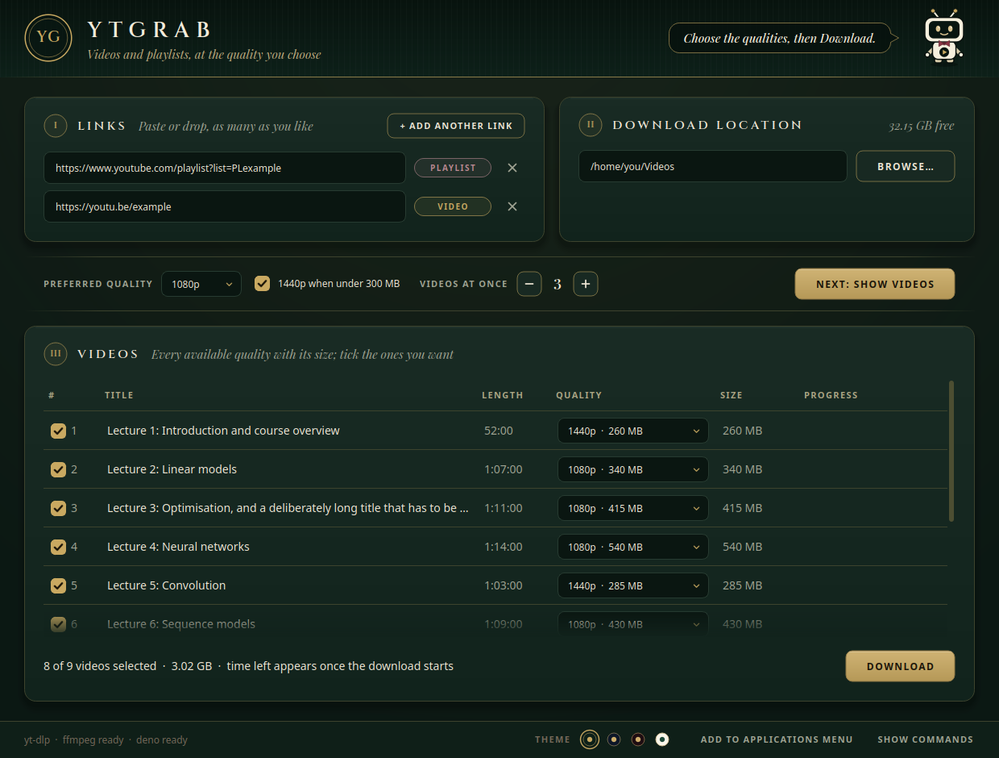
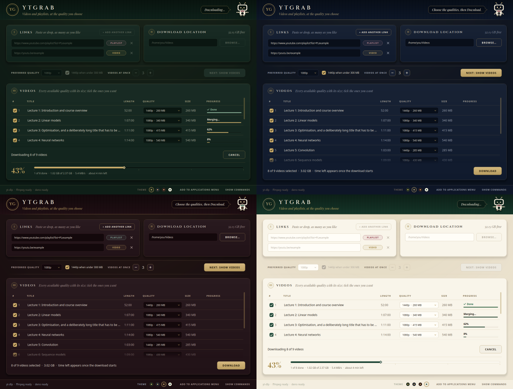

# ytgrab

A small desktop app for downloading videos and playlists, built on [yt-dlp](https://github.com/yt-dlp/yt-dlp).
Paste a link, see every available quality with its size, pick, download. It runs on Windows, macOS and Linux.



## Install

You need Python 3.10 or newer. Everything else comes with it: yt-dlp, an ffmpeg binary, and the Deno
JavaScript runtime that yt-dlp uses for YouTube.

With [uv](https://docs.astral.sh/uv/):

```
uv tool install git+https://github.com/Sankey001/ytgrab
```

or with [pipx](https://pipx.pypa.io/):

```
pipx install git+https://github.com/Sankey001/ytgrab
```

Then start it:

```
ytgrab
```

To have it in the Start menu, the applications menu or the Applications folder, press
**Add to …** in the bottom bar of the window, or run `ytgrab --add-to-menu`.

## Use

1. **I · Links**: paste or drag in a video or playlist link. A tag shows what it was recognised as.
   **+ Add another link** takes more; pasting several links at once spreads them over rows.
2. **II · Download location**: type a folder or press **Browse…**. It is remembered, and the free space on that drive is shown.
3. Press **Next: show videos**. Each video gets a row with a dropdown of every available quality and its size.
4. Press **Download**. A large figure and a bar show the whole batch, with the count, speed and time left under them;
   each row has its own bar.

### Which quality is preselected

- The **Preferred quality** (1080p unless you change it), or the next one down when a video lacks it.
- With **1440p when under 300 MB** ticked, a video whose 1440p version is smaller than 300 MB gets 1440p.

Any row can still be changed by hand.

### Where files go

- A single video lands directly in the download folder.
- A playlist gets its own subfolder, with files numbered in playlist order (`01 - …`, or `001 - …` for
  100 videos or more) so they sort correctly by name.
- File names avoid characters that Windows does not allow, so a folder can move between systems.
- Videos already in the folder are skipped. A failed or cancelled download resumes when you press Download again.

**Show commands** in the bottom bar reveals the exact yt-dlp commands being run.

## Themes



Four themes come with it: **Heritage green**, **Midnight navy**, **Bordeaux** and the light **Ivory**.
Pick one with the swatches in the bottom bar; the choice is remembered. Until you pick, ytgrab follows the
system: Heritage green when the system is dark, Ivory when it is light.

The mark at the top left is a monogram. To have your own picture there, and as the window icon, save it as
`icon.png` in ytgrab's settings folder:

| System | Folder |
|---|---|
| Linux | `~/.config/ytgrab` |
| macOS | `~/Library/Preferences/ytgrab` |
| Windows | `%LOCALAPPDATA%\ytgrab` |

## Speed

Video sites limit how fast each connection may go, so ytgrab fetches many pieces of a video in parallel.

- **A shared budget of connections.** A video downloading alone uses 32 parallel pieces; when several videos
  run at once the budget is divided between them. On the roughly 50 Mbit/s line this was measured on, one lecture
  went from 2.5 MiB/s with 8 pieces to 6.0 MiB/s with 32, which was all the line could carry.
- **One lookup per video, not two.** What the site answers when the table is filled is kept and handed back
  to yt-dlp for the download, so the download starts in about one second instead of two and a half. If that
  answer has gone stale, ytgrab looks the video up again by itself.
- **Six lookups at once** when listing a playlist (fewer on a machine with few cores).

**Videos at once** (1 to 6) sets how many videos download together. More helps when you have a fast line and
many small videos; it cannot make one video faster than your line allows.

## Platform support

| | Tested |
|---|---|
| Linux (GNOME, Wayland) | By hand: listing, downloading, the launcher |
| Windows, macOS | By the automated tests only, which run on all three systems in GitHub Actions |

On Windows on ARM there is no bundled Deno; install [Deno](https://deno.com/) or [Node.js](https://nodejs.org/) yourself.

## Troubleshooting

```
python -m ytgrab --check
```

starts yt-dlp, ffmpeg and the JavaScript runtime once each and says which one fails.

Video sites change often, and an old yt-dlp is the usual reason a download stops working.
Update with `uv tool upgrade ytgrab` or `pipx upgrade ytgrab`.

| Setting | What it does |
|---|---|
| `YTGRAB_THEME=heritage`, `midnight`, `bordeaux` or `ivory` | Use that theme for this run. `dark` and `light` also work |
| `YTGRAB_MOTION=off` | Turn the animations off |
| `YTGRAB_FFMPEG=/path/to/ffmpeg` | Use this ffmpeg. By default a system ffmpeg is preferred, then the bundled one |
| `YTGRAB_YTDLP=/path/to/yt-dlp` | Use this yt-dlp instead of the bundled one |
| `YTGRAB_SETTINGS=/path/to/file.ini` | Keep the saved choices in this file |

## Development

```
git clone https://github.com/Sankey001/ytgrab
cd ytgrab
uv run ytgrab        # start the app from the source tree
uv run pytest        # run the tests; they need no display and no network
```

| File | What it holds |
|---|---|
| `src/ytgrab/app.py` | The window and the download logic |
| `src/ytgrab/widgets.py` | The parts that draw themselves: panels, buttons, progress bars, ornaments |
| `src/ytgrab/dialogs.py` | The app's own question and note dialogs |
| `src/ytgrab/theme.py` | The four themes, and the palette and stylesheet built from them |
| `src/ytgrab/fonts.py` | The two bundled typefaces |
| `src/ytgrab/motion.py` | Animation helpers, and the one switch that turns motion off |
| `src/ytgrab/mascot.py` | The header figurine, drawn in code |
| `src/ytgrab/tools.py` | Finding yt-dlp, ffmpeg and a JavaScript runtime on each system |
| `src/ytgrab/ytdlp.py` | The yt-dlp commands, file naming, progress parsing |
| `src/ytgrab/formats.py` | Qualities, sizes and the preselection rules |
| `src/ytgrab/launcher.py` | The Start menu shortcut, `.desktop` entry and `.app` bundle |
| `src/ytgrab/urls.py` | Video or playlist detection |
| `src/ytgrab/eta.py` | Speed and time-left estimate |
| `tools/make_assets.py` | Regenerates the icon files from the mascot drawing |

## Use it responsibly

Download only what you have the right to save, and follow the terms of the site you download from.

## Licence

[MIT](LICENSE). ytgrab drives yt-dlp, ffmpeg and Deno, and is built with Qt for Python; each has its own licence.

The typefaces in `src/ytgrab/assets/fonts`, Cinzel and Playfair Display, are not covered by the MIT licence.
They are used under the SIL Open Font License 1.1, whose text is in that folder beside them.
